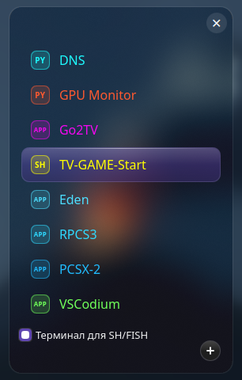
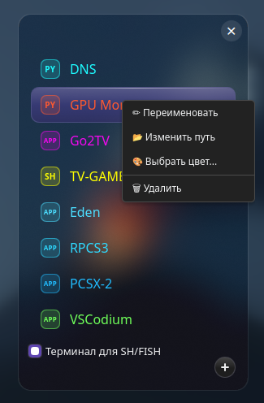

# QM Launcher

Компактный лаунчер на QML/Kirigami для быстрого запуска скриптов и программ: AppImage, `.py`, `.sh`, `.fish`, `.exe`. Панель всегда под рукой и сама прячется после запуска пункта или при смене фокуса.

PyQt6 + Kirigami, Linux.

<p align="center">
  
  
</p>

## Возможности

- **Быстрый запуск** — AppImage, `.py`, `.sh`, `.fish`, `.exe`; для скриптов есть галочка «Терминал для SH/FISH» (запуск в терминале).
- **Сам скрывается** — закрывается после запуска пункта или при переключении фокуса на другое окно.
- **Перетаскивание** — пункты меняются местами мышью, панель можно таскать по экрану.
- **Внешний вид пунктов** — переименование из контекстного меню, свой цвет для каждого пункта.
- **Прозрачность и анимации** — полупрозрачная панель, размытие фона через KWin (Plasma), плавный hover.
- **Тема следует системной цветовой схеме** (Kirigami).
- **Простой JSON-конфиг** — `launcher_config.json` создаётся рядом со скриптом при первом запуске; обычно пункты добавляются через интерфейс (кнопка ➕).

## Запуск

Из исходников:

```bash
# Arch / CachyOS
sudo pacman -S python-pyqt6 kirigami
python3 start.py
```

Или возьмите готовый **AppImage** из [Releases](../../releases) — Python не нужен:

```bash
chmod +x QMLauncher-1.1.0-x86_64.AppImage
./QMLauncher-1.1.0-x86_64.AppImage
```

## Зависимости (для запуска из исходников)

| Пакет | Назначение |
|---|---|
| python-pyqt6 | среда выполнения |
| kirigami | QML-компоненты и тема |

Размытие работает под KWin (Plasma); в других WM панель просто полупрозрачная.

## Лицензия

[MIT](LICENSE)
