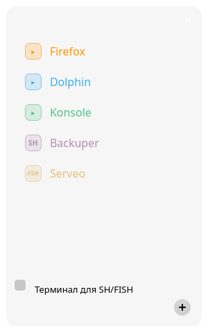

# QM Launcher

[English](#english) | [Русский](#русский)

---

## English

A small QML/Kirigami launcher for scripts and programs: AppImage, `.py`, `.sh`, `.fish`, `.exe`. One compact panel always at hand — it hides itself when an item is launched or when focus leaves the panel.

PyQt6 + Kirigami, Linux.

<p align="center">
  
</p>

### Features

- **Quick launch** — AppImage, `.py`, `.sh`, `.fish`, `.exe`; scripts can run in a terminal (checkbox «Terminal for SH/FISH»)
- **Self-hiding** — closes after launching an item or when it loses focus
- **Drag & drop** — reorder items with the mouse, drag the panel itself around the screen
- **Per-item look** — rename from the context menu, set a custom color for each item
- **Transparency and animations** — translucent panel, KWin blur on Plasma, smooth hover effects
- **Theme follows the system color scheme** (Kirigami)
- **Plain JSON config** — `launcher_config.json` is created next to the script on first run; items are usually managed from the UI (+ button)

### Run

From source:

```bash
# Arch / CachyOS
sudo pacman -S python-pyqt6 kirigami
python3 start.py
```

Or grab the ready **AppImage** from [Releases](../../releases) — no Python needed:

```bash
chmod +x QMLauncher-1.1.0-x86_64.AppImage
./QMLauncher-1.1.0-x86_64.AppImage
```

### Dependencies (from source)

| Package | Purpose |
|---|---|
| python-pyqt6 | UI runtime |
| kirigami | QML components and theming |

Blur works under KWin (Plasma); on other WMs the panel is simply transparent.

---

## Русский

Компактный лаунчер на QML/Kirigami для быстрого запуска скриптов и программ: AppImage, `.py`, `.sh`, `.fish`, `.exe`. Панель всегда под рукой и сама прячется после запуска пункта или при смене фокуса.

PyQt6 + Kirigami, Linux.

<p align="center">
  
</p>

### Возможности

- **Быстрый запуск** — AppImage, `.py`, `.sh`, `.fish`, `.exe`; для скриптов есть галочка «Терминал для SH/FISH» (запуск в терминале).
- **Сам скрывается** — закрывается после запуска пункта или при переключении фокуса на другое окно.
- **Перетаскивание** — пункты меняются местами мышью, панель можно таскать по экрану.
- **Внешний вид пунктов** — переименование из контекстного меню, свой цвет для каждого пункта.
- **Прозрачность и анимации** — полупрозрачная панель, размытие фона через KWin (Plasma), плавный hover.
- **Тема следует системной цветовой схеме** (Kirigami).
- **Простой JSON-конфиг** — `launcher_config.json` создаётся рядом со скриптом при первом запуске; обычно пункты добавляются через интерфейс (кнопка ➕).

### Запуск

Из исходников:

```bash
# Arch / CachyOS
sudo pacman -S python-pyqt6 kirigami
python3 start.py
```

Или возьмите готовый **AppImage** из [Releases](../../releases) — Python не нужен:

```bash
chmod +x QMLauncher-1.1.0-x86_64.AppImage
./QMLauncher-1.1.0-x86_64.AppImage
```

### Зависимости (для запуска из исходников)

| Пакет | Назначение |
|---|---|
| python-pyqt6 | среда выполнения |
| kirigami | QML-компоненты и тема |

Размытие работает под KWin (Plasma); в других WM панель просто полупрозрачная.

---

## License / Лицензия

[MIT](LICENSE)
